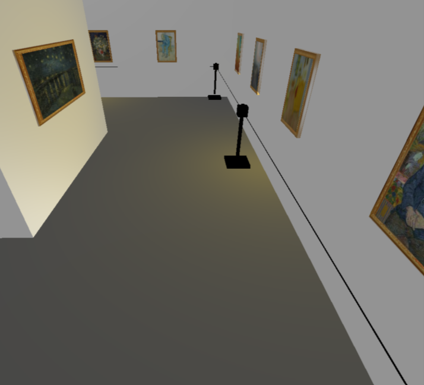
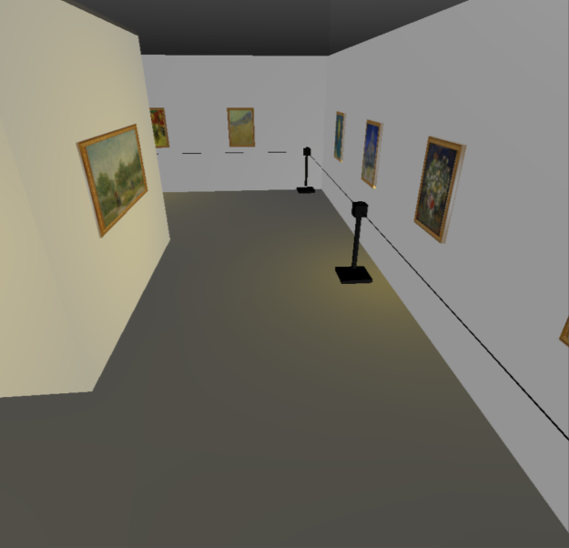
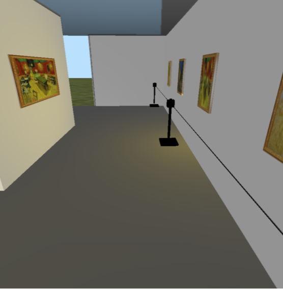
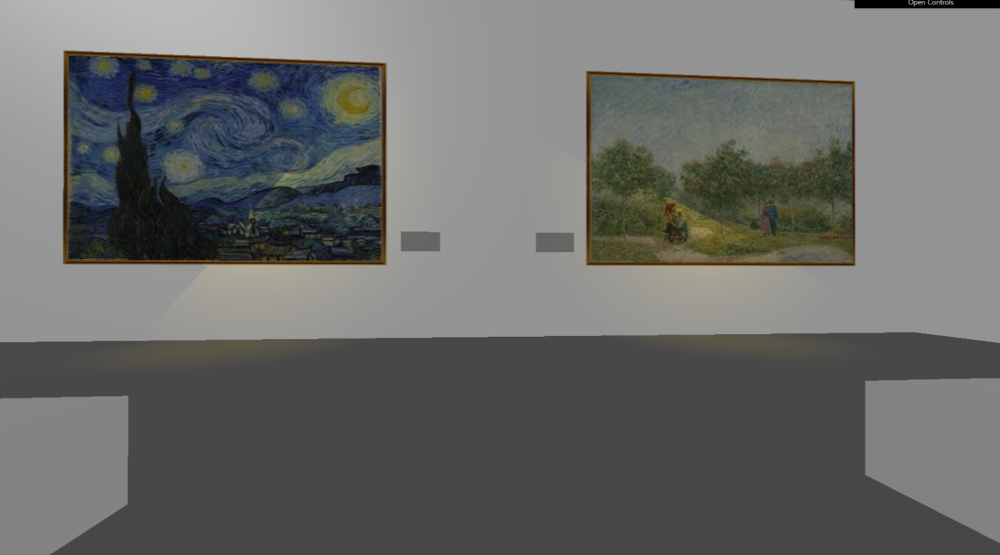
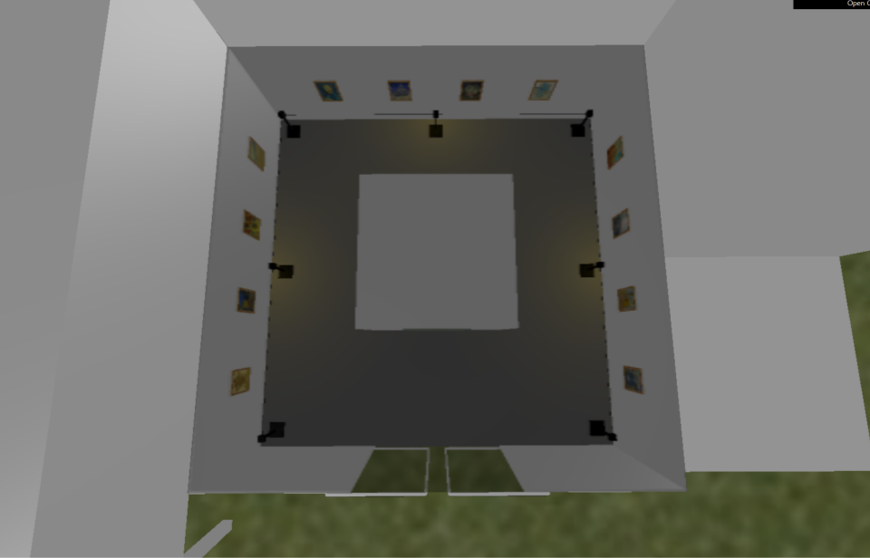
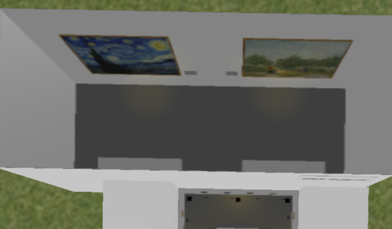

# 🖼️ MinA Museum — Three.js 3D Art Gallery

> 웹 브라우저에서 바로 관람할 수 있는 **빈센트 반 고흐 가상 미술관**
> Three.js로 건물·조명·작품·인터랙션을 직접 모델링하고 구현한 컴퓨터그래픽스 프로젝트입니다.


<br/>

## 📌 프로젝트 개요

| 항목 | 내용 |
| --- | --- |
| 프로젝트명 | **MinA Museum** (ArtGalleryByThreeJS) |
| 과목 | 컴퓨터그래픽스 (Computer Graphics) |
| 개발자 | 심민아 (소프트웨어학부) |
| 주제 | 반 고흐 작품을 전시한 3D 가상 미술관 |
| 기술 스택 | `HTML` · `JavaScript` · `Three.js` · `dat.GUI` |

여러 개의 사각형 매스로 이루어진 미술관 건물을 직접 모델링했습니다.
개방된 공간은 **입구와 연결된 메인 홀**과 뒤쪽에 크게 지어진 **본관**으로 구성되어 있으며, 반 고흐의 대표작들이 전시되어 있습니다.

<br/>

## 🏛️ 공간 소개

### 1. 미술관 정면

- 박스 형태의 매스를 조합해 현대 미술관 느낌의 외관을 구성
- 건물 상단에 **"MinA museum"** 로고 간판 (텍스처 매핑)
- 입구의 **자동 슬라이딩 도어**가 열렸다 닫히는 애니메이션
- 잔디 바닥 텍스처, 외부 기둥, 나무 오브젝트로 주변 환경 연출

### 2. 메인 홀 (Main Exhibition)

<p>
  
  
  
</p>

- 반 고흐의 작품 **15점**을 벽면을 따라 전시
- 작품 분위기에 맞춘 **은은한 노란빛 스포트라이트** 조명
- 작품 훼손 방지를 위한 **가드라인(차단봉 + 베지어 곡선 로프)** 설치

### 3. 본관 (Exhibition)



- 대표작 **〈별이 빛나는 밤〉**, **〈연인이 있는 정원, 생피에르 광장〉** 을 대형 화면으로 전시
- 각 작품 아래 작품 설명 패널 배치
- 관람객이 앉아서 감상할 수 있는 **의자** 배치

### 4. 위에서 본 모습

<p>
  
  
</p>

카메라 이동에 제한이 있는 부분을 보완하기 위해 천장을 **투명 유리**로 만들어, 위에서도 내부 전시 공간을 한눈에 내려다볼 수 있습니다.

<br/>

## ✨ 주요 구현 내용

### 🎨 텍스처 매핑 & 액자
- `TextureLoader`로 작품 이미지를 불러와 `BoxGeometry`에 매핑
- 작품마다 액자 텍스처를 입힌 프레임을 별도로 만들어 둘러줌

### 💡 조명
| 조명 | 용도 |
| --- | --- |
| `SpotLight` (노란색 `0xffcc00`) | 작품 위에서 비추는 전시 조명 |
| `AmbientLight` | 전체 공간의 부족한 빛 보충 (노을 분위기) |
| `PointLight` | 실내 보조 조명 |
| `DirectionalLight` | 외부 햇빛 |

`dat.GUI` 패널에서 각 조명을 **켜고 끄며** 분위기 변화를 확인할 수 있습니다.

### 🪟 투명 유리 천장
- `MeshPhysicalMaterial`의 `transmission` 속성을 이용해 유리 재질 구현

### 🚪 자동문 애니메이션
- `requestAnimationFrame` 루프에서 `Math.sin()`을 이용해 좌우 문이 주기적으로 열리고 닫히도록 구현

### 🧍 3D 캐릭터
- `GLTFLoader`로 사람 모델(`human.glb`)을 불러와 씬에 배치
- 방향키로 캐릭터를 이동시킬 수 있음

### 🌳 기타 오브젝트
- 여러 지오메트리를 `Group`으로 묶어 나무 오브젝트 제작
- `QuadraticBezierCurve`로 가드라인 로프 표현

<br/>

## 🎮 조작 방법

| 입력 | 동작 |
| --- | --- |
| `마우스 드래그` | 시점 회전 (OrbitControls) |
| `마우스 휠` | 줌 인 / 아웃 |
| `W` / `S` | 카메라 전진 / 후진 |
| `A` / `D` | 카메라 좌 / 우 이동 |
| `Q` / `E` | 카메라 위 / 아래 이동 |
| `방향키 ↑ ↓ ← →` | 캐릭터 이동 |
| `GUI 패널` | 조명 On / Off |

<br/>

## 🚀 실행 방법

텍스처와 GLB 모델을 불러오기 때문에 파일을 직접 여는 대신 **로컬 서버**에서 실행해야 합니다.

```bash
git clone https://github.com/S1mM1na/ArtGallery.git
cd ArtGallery

# 방법 1) Python
python -m http.server 8000

# 방법 2) Node.js
npx serve .
```

브라우저에서 `http://localhost:8000/project2.html` 로 접속한 뒤, 화면을 클릭하면 관람이 시작됩니다.

> VS Code를 사용한다면 **Live Server** 확장으로 `project2.html`을 열어도 됩니다.

<br/>

## 📁 프로젝트 구조

```
ArtGallery
├── project2.html          # 메인 씬 (모델링 · 조명 · 인터랙션)
├── three.js               # Three.js 라이브러리
├── OrbitControls.js       # 마우스 시점 컨트롤
├── PointerLockControls.js
├── GLTFLoader.js          # GLB 모델 로더
├── dat.gui.js             # 조명 컨트롤 GUI
├── Stats.js / WebGL.js
├── textures/              # 작품 이미지, 액자·잔디 텍스처, human.glb
└── images/                # README 이미지
```

<br/>

